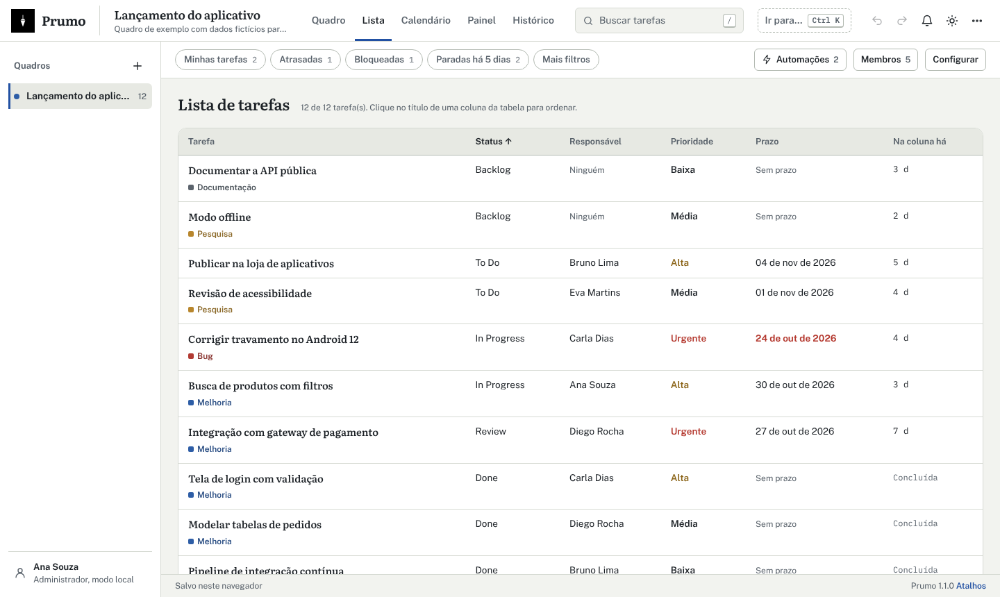
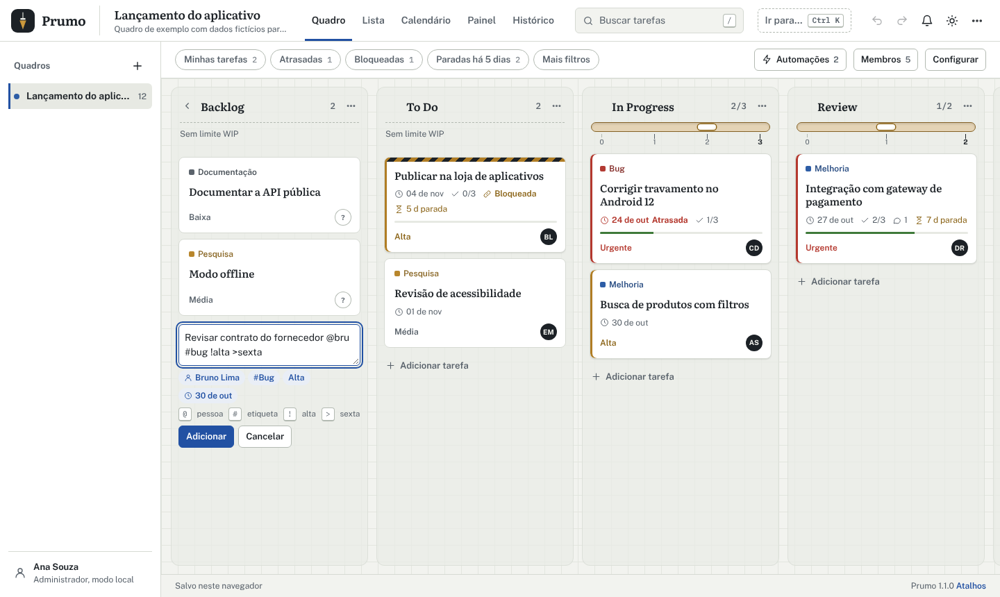
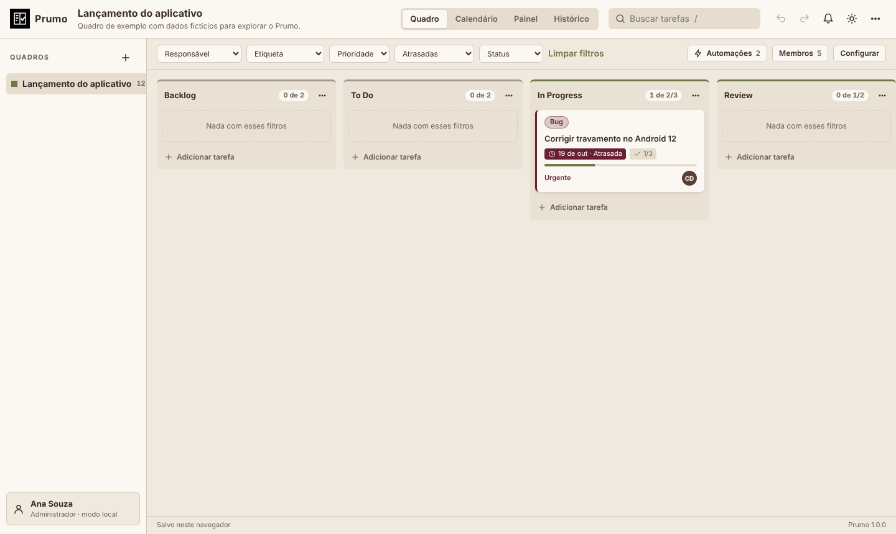
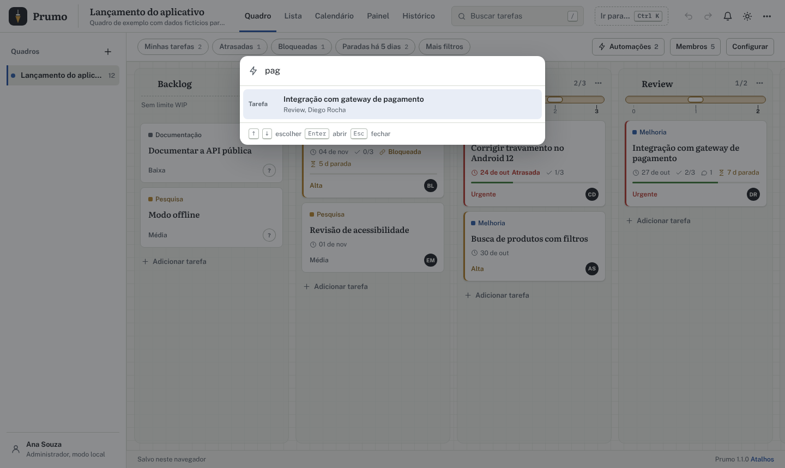
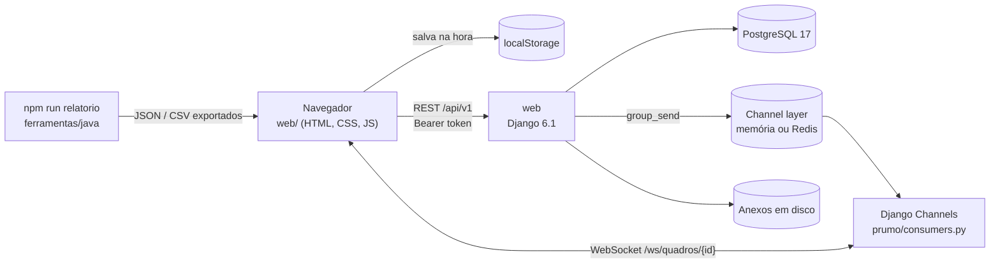
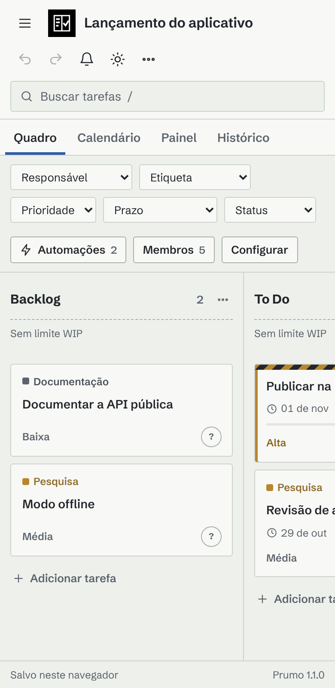

<p align="center">
  
</p>

<h1 align="center">Prumo<br><sub><sup><sup><sub>Copyright (©) 2026 Clara Portes</sub></sup></sup></sub></h1>

<p align="center">
  <b>Quadro Kanban interativo para organizar tarefas sozinho ou em equipe.</b><br>
  Você arrasta as tarefas entre colunas; o Prumo controla limites WIP e dependências, aplica automações, mostra o que está parado e calcula lead time, cycle time e throughput, no navegador ou com um servidor em tempo real.
</p>

<p align="center">
  <code>JavaScript (ES modules)</code> · <code>HTML5 Drag and Drop</code> · <code>Python 3.13</code> · <code>Django 6.1</code> · <code>Django Channels</code> · <code>PostgreSQL 17</code> · <code>WebSocket</code> · <code>Java 21</code> · <code>Node.js</code> · <code>Docker Compose</code>
</p>

<p align="center">
  <a href="#como-rodar">Como rodar</a> ·
  <a href="Manual-Prumo.pdf">Manual (PDF)</a> ·
  <a href="Banco-de-Dados-Prumo.pdf">Banco de dados (PDF)</a> ·
  <a href="#usando-a-api">API</a> ·
  <a href="#design-e-acessibilidade">Design</a> ·
  <a href="#licença">Licença</a>
</p>

<p align="center">
  
</p>

---

## Sumário

- [Visão geral](#visão-geral)
- [Novidades da versão 1.1](#novidades-da-versão-11)
- [Telas](#telas)
- [Arquitetura](#arquitetura)
- [Como rodar](#como-rodar)
- [Contas de demonstração](#contas-de-demonstração)
- [Adição rápida](#adição-rápida)
- [Usando a API](#usando-a-api)
- [Configuração](#configuração)
- [Design e acessibilidade](#design-e-acessibilidade)
- [Desenvolvimento e testes](#desenvolvimento-e-testes)
- [Documentação em PDF](#documentação-em-pdf)
- [Parceria](#parceria)
- [Licença](#licença)

## Visão geral

O Prumo resolve um problema comum: tarefas espalhadas em listas, conversas e planilhas, sem saber quem está com o quê, o que travou e quanto tempo cada coisa leva. Ele junta tudo num quadro Kanban que funciona sozinho no navegador ou com um servidor para a equipe inteira, com as alterações chegando a todos na hora.

| | O que o Prumo faz |
|---|---|
| **Quadro** | Colunas que você arrasta com o mouse ou pelo teclado, cada uma com um tipo (espera, em andamento ou concluído). Colunas fora de uso podem ser recolhidas. Modelos prontos: Kanban, Scrum, Desenvolvimento, Estudos e Gestão de projetos. |
| **Tarefas** | Título, descrição, responsável, prioridade (urgente, alta, média, baixa), status, início e prazo, subtarefas com barra de progresso, anexos, comentários com `@menção` e histórico de cada alteração. |
| **Adição rápida** | `Revisar contrato @ana #bug !alta >sexta` já preenche responsável, etiqueta, prioridade e prazo, com prévia antes de salvar. |
| **Fluxo** | Limite WIP por coluna (um nível de bolha que fica vermelho quando lota), dependências que bloqueiam a tarefa e recusam ciclos, e selo para o que está parado há 5 dias ou mais na mesma coluna. |
| **Automações** | Regras como “quando entrar em Review, atribuir ao Bruno” ou “quando for criada em To Do, prazo em 3 dias”: definir responsável, prioridade, etiqueta, prazo, mover de coluna e marcar subtarefas. Cada regra pode ser pausada. |
| **Vistas** | Quadro, lista ordenável, calendário do mês, painel de métricas (lead time, cycle time, throughput, fluxo cumulativo de 14 dias, desempenho por responsável) e histórico. **Ir para** (`Ctrl` + `K`) acha qualquer tarefa, quadro, vista ou ação. |
| **Filtros** | Busca por texto e filtros rápidos com contagem (Minhas tarefas, Atrasadas, Bloqueadas, Paradas há 5 dias); responsável, etiqueta, prioridade, prazo e status ficam em **Mais filtros**, tudo combinado. |
| **Equipe** | Contas, papéis por quadro (administrador, gerente, membro e visualizador), sincronização por WebSocket, quem está online e notificações de prazos, atribuições, menções e alterações. |
| **Dados** | Salva no `localStorage` ou no PostgreSQL, desfaz e refaz até 100 passos, exporta e importa JSON e CSV e gera relatórios pela linha de comando em Node e em Java. |

## Novidades da versão 1.1

A 1.1 é uma revisão de design e de experiência de uso. Nenhuma tabela, rota da API ou formato JSON mudou: quadros exportados antes abrem sem conversão.

- **Mesa de obra.** O quadro fica sobre papel milimetrado, cada coluna é uma raia e as tarefas são fichas brancas com o título em serifa. O logo é um prumo de pedreiro em branco sobre um quadrado preto.
- **Três vozes tipográficas.** As mesmas do Lume: Literata nos títulos e nas tarefas, Public Sans na interface e **IBM Plex Mono** nos números (contagens, limite WIP, dias na coluna). As três são auto-hospedadas.
- **Adição rápida.** Marcações no título preenchem os campos da tarefa na hora, com prévia e aviso quando algo não é reconhecido.
- **Filtros que respondem.** Os cinco seletores viraram filtros rápidos com contagem; o resto foi para **Mais filtros**.
- **Menos cliques no card.** Ações rápidas para assumir a tarefa ou mandá-la para a próxima coluna, e selo de tarefa parada.
- **Novas vistas.** Lista ordenável, colunas recolhidas e **Ir para** com `Ctrl` + `K`.
- **Sinais visuais do fluxo.** O limite WIP aparece como um nível de bolha com régua; tarefa bloqueada ganha uma faixa zebrada; prioridade urgente ou alta vira uma barra à esquerda do card; os seletores de cor mostram nomes em vez de códigos.
- **Documentação.** Manual e documento do banco reescritos e diagramados de novo, agora com a fonte em HTML no repositório (`docs/fonte/`) para serem regenerados a cada versão.

## Telas

| | |
|---|---|
|  |  |
| **Tarefa** — subtarefas, dependências, anexos, comentários e histórico. | **Painel** — lead time, cycle time, throughput e fluxo cumulativo. |
|  |  |
| **Lista** — todas as tarefas numa tabela que ordena por qualquer coluna. | **Calendário** — os prazos do mês e a lista de atrasadas. |
|  |  |
| **Adição rápida** — as marcações viram campos antes de salvar. | **Filtros** — um clique em Atrasadas, com a contagem de cada filtro. |
|  |  |
| **Automações** — regras por coluna, que podem ser pausadas. | **Ir para** — qualquer tarefa, quadro, vista ou ação com `Ctrl` + `K`. |
|  |  |
| **Histórico** — quem fez o quê e quando, no quadro e em cada tarefa. | **Tema escuro** — mesma hierarquia, papel milimetrado escuro. |

## Arquitetura



| Serviço | Linguagem | Responsabilidade |
|---|---|---|
| Navegador | JavaScript (módulos ES, sem build) | Quadro, lista, calendário, painel e histórico; regras do Kanban (mover, WIP, dependências, automações), desfazer e refazer, salvamento no `localStorage` |
| `web` | Python (Django 6.1, Channels, Daphne) | API REST, contas e tokens, papéis por quadro, revisão otimista, histórico com autor, anexos e WebSocket |
| `postgres` | — | Fonte da verdade: quadros com revisão, membros, histórico, anexos e tokens |
| Channel layer | memória ou Redis | Avisa os outros navegadores; Redis só quando houver mais de uma instância do `web` |
| `scripts/relatorio.js` | Node.js | Relatório de produtividade a partir do JSON exportado |
| `ferramentas/java` | Java 21 | Resumo, atrasadas e responsáveis a partir do CSV exportado |

### Como o salvamento funciona

1. Toda alteração passa por `Loja.alterar()`, que guarda o estado anterior na pilha de desfazer e grava no `localStorage`.
2. Se o quadro está no servidor, o Prumo envia `PUT /api/v1/quadros/{id}` com a revisão que conhece e os registros novos do histórico.
3. O servidor trava a linha (`select_for_update`) e confere a revisão. Se alguém salvou antes, responde 409 com a versão atual, que o navegador carrega na hora.
4. Ao aceitar, o servidor soma 1 à revisão, grava os registros com o autor do token e avisa os outros navegadores pelo WebSocket.
5. Membros não alteram colunas, etiquetas e automações; visualizadores não alteram nada. A regra vale no servidor, não só na tela.

O modelo de dados completo — diagrama de relacionamentos, cada tabela com campos, tipos, chaves e restrições, o formato JSON do quadro, o controle de revisões e consultas prontas — está em [`Banco-de-Dados-Prumo.pdf`](Banco-de-Dados-Prumo.pdf).

### Segurança

| Regra | Como funciona |
|---|---|
| Senhas | Hasher padrão do Django (PBKDF2 com sal), mínimo de 8 caracteres e não só números |
| Tokens | Aleatórios de 256 bits; só o SHA-256 fica no banco. Expiram em 7 dias e são revogados ao sair |
| Papéis | Conferidos em cada rota e na conexão do WebSocket |
| Conflitos | Revisão otimista com trava de linha: ninguém sobrescreve uma versão que não viu |
| Anexos | Nome aleatório no disco, tamanho limitado e download com `nosniff` e CSP restrita |
| Dados | Nenhum dado pessoal real no repositório. Segredos só no `.env`, que fica fora do Git |

## Como rodar

Você só precisa do **Docker** com Docker Compose.

**Windows:** dê dois cliques em `iniciar.cmd`.

**Linux ou macOS:**

```bash
./iniciar.sh
```

Na primeira vez o script cria o arquivo `.env` com uma senha aleatória para o banco e uma chave secreta aleatória, sobe o PostgreSQL e o Prumo e abre **http://localhost:8080**.

| Endereço | O que é |
|---|---|
| http://localhost:8080 | Quadro |
| http://localhost:8080/api/v1/ | Lista das rotas da API |
| http://localhost:8080/api/v1/saude | Estado do servidor |

Para rodar sem o script:

```bash
cp .env.example .env            # troque PRUMO_DB_PASSWORD e PRUMO_SECRET_KEY
docker compose up -d --build
docker compose logs -f web      # acompanhar o servidor
```

**Sem Docker nem banco:** com o Node 20 ou mais novo, `npm run servir` abre só a interface em http://localhost:5173. Tudo fica salvo no navegador.

> Atualizando da 1.0? Rode `docker compose up -d --build`. O banco e o formato JSON não mudaram; só a interface é nova.

## Contas de demonstração

Todas usam a senha **`Prumo@2026`**. Elas existem só para testes, para qualquer pessoa entrar logo depois de baixar o projeto. Os nomes, o quadro de [`exemplos/`](exemplos) e o domínio `prumo.dev` são fictícios.

| Papel | E-mail | O que pode fazer |
|---|---|---|
| Administrador | `admin@prumo.dev` | Tudo, incluindo membros e exclusão do quadro |
| Gerente | `gerente@prumo.dev` | Tarefas, colunas, etiquetas, limites WIP e automações |
| Membro | `membro@prumo.dev` | Criar, editar, mover e comentar tarefas |
| Visualizador | `leitura@prumo.dev` | Só consultar |

Para entrar, clique no seu nome no canto inferior esquerdo e use **Entrar no servidor**.

Para usar de verdade, suba com `PRUMO_SEED=false` num banco vazio e crie seu administrador:

```bash
docker compose exec web python manage.py criarusuario --email voce@empresa.com --nome "Seu Nome" --admin
```

## Adição rápida

Ao criar uma tarefa, o título aceita marcações que preenchem os campos na hora. A prévia mostra o que foi entendido antes de salvar.

| Marcação | Exemplo | Preenche |
|---|---|---|
| `@pessoa` | `@ana` | Responsável, entre quem já está no quadro (basta o começo do nome) |
| `#etiqueta` | `#bug` · `#nova-funcao` | Etiqueta existente; use hífen no lugar do espaço |
| `!prioridade` | `!alta` · `!u` | `urgente`, `alta`, `media` ou `baixa` (ou `u`, `a`, `m`, `b`) |
| `>prazo` | `>sexta` · `>amanha` · `>15/11` · `>+3` | Prazo: hoje, amanhã, dia da semana, data (com ou sem ano) ou daqui a N dias |

```text
Revisar contrato @ana #bug !alta >sexta
```

Vira a tarefa “Revisar contrato”, com Ana como responsável, a etiqueta `bug`, prioridade alta e prazo na próxima sexta. O que não for reconhecido (uma pessoa fora do quadro, uma etiqueta que não existe, uma data inválida) aparece como aviso na prévia e fica de fora. A interpretação mora em `interpretarEntrada`, em `web/js/entrada.js`.

## Usando a API

Faça login em `POST /api/v1/auth/entrar` para receber um token e envie no cabeçalho `Authorization: Bearer <token>`. O token expira em 7 dias e é revogado ao sair.

```bash
# entrar e guardar o token
TOKEN=$(curl -s -X POST localhost:8080/api/v1/auth/entrar -H 'Content-Type: application/json' \
  -d '{"email":"gerente@prumo.dev","senha":"Prumo@2026"}' | jq -r .token)

# tarefas de uma pessoa
curl -s "localhost:8080/api/v1/quadros/qdr_demonstracao/tarefas?responsavel=Carla%20Dias" \
  -H "Authorization: Bearer $TOKEN"

# convidar alguém como membro
curl -s -X POST localhost:8080/api/v1/quadros/qdr_demonstracao/membros -H "Authorization: Bearer $TOKEN" \
  -H 'Content-Type: application/json' -d '{"email":"membro@prumo.dev","papel":"membro"}'
```

| Rota | O que faz |
|---|---|
| `POST /auth/entrar` · `POST /auth/sair` · `GET /auth/eu` | Login, logout e dados da conta |
| `GET` e `POST /quadros` | Lista os quadros da conta e cria um novo |
| `GET/PUT/DELETE /quadros/{id}` | Quadro completo, salvamento com revisão e exclusão |
| `GET /quadros/{id}/historico` | Registros do histórico com autor e horário |
| `GET /quadros/{id}/tarefas` | Tarefas filtradas por `coluna`, `responsavel`, `etiqueta` e `prioridade` |
| `GET` e `POST /quadros/{id}/membros` | Membros e papéis (`{ "email", "papel" }`; papel `remover` tira o acesso) |
| `POST /quadros/{id}/anexos` · `GET /anexos/{id}` | Envio (multipart: `card`, `arquivo`) e download de anexos |
| `WS /ws/quadros/{id}/?token=...` | Eventos `quadro`, `presenca` e `excluido` em tempo real |

Todas as rotas ficam em `/api/v1`, respondem JSON e exigem token, exceto login, saúde e o índice. Erros vêm sempre como `{ "mensagem": "..." }`. A referência completa está no capítulo de API do manual.

### Relatórios pela linha de comando

Exporte o quadro em **Menu › Exportar e importar** e rode:

```bash
npm run relatorio -- quadro.json                               # JavaScript (Node)
bash ferramentas/java/prumo.sh resumo tarefas.csv              # Java 21
bash ferramentas/java/prumo.sh atrasadas tarefas.csv
bash ferramentas/java/prumo.sh responsaveis tarefas.csv
```

No Windows, use `ferramentas\java\prumo.cmd` no lugar de `prumo.sh`.

## Configuração

As principais variáveis do `.env` (modelo em [`.env.example`](.env.example); a lista completa está no manual):

| Variável | Padrão | O que faz |
|---|---|---|
| `PRUMO_PORT` | `8080` | Porta no navegador |
| `PRUMO_SECRET_KEY` | — | Chave do Django. Gerada pelos scripts; nunca publique a sua |
| `PRUMO_ALLOWED_HOSTS` | `localhost,127.0.0.1` | Endereços pelos quais o Prumo é acessado |
| `PRUMO_HTTPS` | `false` | Redireciona para HTTPS atrás de um proxy |
| `PRUMO_SEED` | `true` | Contas e quadro de demonstração num banco vazio |
| `PRUMO_DB_NAME` / `PRUMO_DB_USER` / `PRUMO_DB_PASSWORD` | `prumo` / `prumo` / — | PostgreSQL |
| `PRUMO_MAX_ANEXO_MB` | `20` | Tamanho máximo de cada anexo |
| `PRUMO_TOKEN_HORAS` | `168` | Validade do login |
| `PRUMO_REDIS_URL` | vazio | Redis no channel layer, para rodar mais de uma instância |
| `PRUMO_TIMEZONE` | `America/Sao_Paulo` | Fuso do servidor |

## Design e acessibilidade

A interface não usa framework de CSS: tudo sai de tokens no topo de `web/css/prumo.css`, com tema claro, escuro ou do sistema trocados por `data-theme`. O tema é uma mesa de obra: papel milimetrado, tinta grafite, o azul da linha de giz e o latão do nível.

| Papel | Claro | Escuro | Uso |
|---|---|---|---|
| Mesa | `#F2F3EF` Giz | `#15181B` | Fundo com a grade de papel milimetrado |
| Ficha | `#FFFFFF` Cal | `#1E2226` | Cards, janelas e painéis |
| Tinta | `#1C2126` Grafite | `#E1E4E8` | Texto e títulos |
| Ação | `#2251A3` Azul linha de giz | `#7EA6E6` | Botões, links, seleção e foco |
| Destaque | `#B07D24` Latão | `#D3A54A` | Nível WIP, prioridade alta e avisos |
| Concluído | `#3F7A3A` Verde | `#84C062` | Tarefas concluídas e gráficos |
| Perigo | `#B4382E` Vermelho | `#E5776D` | Urgente, atrasada e WIP estourado |
| Logo | `#000000` e `#FFFFFF` | idem | Sempre em preto e branco, num quadrado sem cantos arredondados |

**Tipografia:** Literata (títulos e tarefas) · Public Sans (interface) · IBM Plex Mono (contagens, limite WIP e dias na coluna). As três são auto-hospedadas em `web/fonts`, sem chamadas a serviços externos.

**Acessibilidade:** tarefas que se movem pelo teclado (`Alt` + setas), foco visível em todos os controles, avisos e prévia da adição rápida lidos por leitores de tela (`aria-live`), rótulos ARIA nas ações só com ícone e animações desligadas com `prefers-reduced-motion`.

**Atalhos de teclado**

| Onde | Tecla | Ação |
|---|---|---|
| Geral | <kbd>Ctrl</kbd> + <kbd>K</kbd> | Ir para tarefa, quadro, vista ou ação |
| Geral | <kbd>Ctrl</kbd> + <kbd>Z</kbd> · <kbd>Ctrl</kbd> + <kbd>Y</kbd> | Desfazer e refazer |
| Geral | <kbd>1</kbd> a <kbd>5</kbd> | Quadro, lista, calendário, painel e histórico |
| Geral | <kbd>?</kbd> | Lista de atalhos |
| Quadro | <kbd>/</kbd> | Buscar |
| Quadro | <kbd>N</kbd> | Nova tarefa na primeira coluna |
| Quadro | <kbd>M</kbd> | Só as minhas tarefas |
| Card | <kbd>Enter</kbd> | Abrir a tarefa em foco |
| Card | <kbd>Alt</kbd> + <kbd>←</kbd> <kbd>→</kbd> | Mover a tarefa entre colunas |
| Card | <kbd>Alt</kbd> + <kbd>↑</kbd> <kbd>↓</kbd> | Mudar a ordem na coluna |

<p align="center">
  
</p>

## Desenvolvimento e testes

Sem Docker, com Node 20 e Python 3.13:

```bash
# só a interface
npm run servir                   # http://localhost:5173

# servidor (em outro terminal)
pip install -r requirements.txt
python manage.py migrate && python manage.py seed
daphne prumo.asgi:application
```

Sem `PRUMO_DB_ENGINE=postgresql`, o Django usa SQLite.

```bash
npm test                                   # núcleo em JavaScript (node --test)
python manage.py test prumo                # API, permissões e WebSocket
bash ferramentas/java/testar.sh            # ferramenta em Java
```

São 35 testes do núcleo (mover, WIP, dependências e ciclos, automações em cadeia, desfazer e refazer, métricas, filtros, adição rápida, notificações, CSV e JSON, cliente da API) e 20 do servidor (login, tokens, revisão e conflito, papéis, membros, anexos e WebSocket). O GitHub Actions roda tudo, com PostgreSQL 17, a cada push.

### Estrutura

```text
web/                 interface sem build: index.html, css/prumo.css e js/
  js/                regras, estado, métricas, filtros, adição rápida (entrada.js), CSV, API e app
  js/ui/             quadro, tarefa, vistas, diálogos e Ir para (comandos.js)
  fonts/             Literata, Public Sans e IBM Plex Mono (OFL)
prumo/               servidor Django: modelos, API REST, WebSocket, comandos seed e criarusuario, testes
ferramentas/java/    relatórios em Java 21 a partir do CSV
scripts/             servidor local, relatório em Node e utilitários
tests/js/            testes do núcleo (node --test)
exemplos/            quadro de demonstração em JSON
docs/                manuais em PDF, imagens do README e fonte dos manuais (docs/fonte)
.github/workflows/   CI e atividade diária
```

### Onde mexer

| Para | Onde |
|---|---|
| Mudar as cores | Variáveis no topo de `web/css/prumo.css` (a grade do papel usa `--grade`) |
| Criar uma marcação da adição rápida | `interpretarEntrada` em `web/js/entrada.js` |
| Criar um modelo de quadro | `MODELOS` em `web/js/modelos.js` |
| Criar uma ação de automação | `DESCRICOES_ACAO` e `executarAutomacoes` em `web/js/regras.js`, e o campo em `web/js/ui/dialogos.js` |
| Adicionar uma métrica | `web/js/metricas.js` e `renderizarPainel` em `web/js/ui/vistas.js` |
| Mudar o que cada papel pode | `web/js/permissoes.js` (tela) e `exigir` em `prumo/views.py` (servidor) |
| Mudar o quadro de exemplo | `web/js/demonstracao.js` e depois `node scripts/exportar-exemplo.js` |

### Como contribuir

1. Abra uma issue descrevendo a ideia ou o problema.
2. Crie uma branch a partir da `main` e envie um pull request.
3. Mudou algo visível? Atualize as capturas em `docs/images` e regenere os PDFs.
4. Quando a mudança for feita em dupla, inclua a linha `Co-authored-by:` no commit para que as duas pessoas recebam o crédito.

## Documentação em PDF

| Documento | Conteúdo |
|---|---|
| [`Manual-Prumo.pdf`](Manual-Prumo.pdf) | Instalação, cada tela, arrastar e soltar, adição rápida, automações, limites WIP, dependências, permissões, métricas, importação e exportação, API, ferramenta em Java, configuração, atalhos e solução de problemas |
| [`Banco-de-Dados-Prumo.pdf`](Banco-de-Dados-Prumo.pdf) | Diagrama de relacionamentos, todas as tabelas com campos, tipos, chaves e restrições, formato JSON do quadro, controle de revisões, consultas prontas e preparação do PostgreSQL |

Cópias idênticas ficam em [`docs/`](docs). Os dois são gerados a partir de HTML e CSS em [`docs/fonte`](docs/fonte), na mesma identidade da interface:

```bash
pip install weasyprint==70.0
python docs/fonte/gerar_pdfs.py          # os dois; ou "manual" / "banco"
```

## Parceria

Projeto desenvolvido em parceria com meu parceiro de projetos e de vida Erik Pimenta (@ravelroot).

O repositório oficial fica em [Violet-pixel/Interactive-Kanban-Board](https://github.com/Violet-pixel/Interactive-Kanban-Board).

### Componentes de terceiros

O Prumo inclui ou depende de componentes com licenças próprias, que continuam valendo para cada um deles:

| Componente | Uso no projeto | Licença |
|---|---|---|
| [Django](https://www.djangoproject.com/) | Back-end web e API | BSD-3-Clause |
| [Django Channels](https://github.com/django/channels) e [channels-redis](https://github.com/django/channels_redis) | WebSocket e channel layer | BSD-3-Clause |
| [Daphne](https://github.com/django/daphne) | Servidor ASGI | BSD-3-Clause |
| [WhiteNoise](https://whitenoise.readthedocs.io/) | Arquivos estáticos da interface | MIT |
| [psycopg](https://www.psycopg.org/) | Conexão com o PostgreSQL | LGPL-3.0 |
| [Public Sans](https://public-sans.digital.gov/) | Fonte da interface | SIL Open Font License 1.1 |
| [Literata](https://github.com/googlefonts/literata) | Fonte dos títulos e das tarefas | SIL Open Font License 1.1 |
| [IBM Plex Mono](https://github.com/IBM/plex) | Fonte dos números e contadores | SIL Open Font License 1.1 |
| [WeasyPrint](https://weasyprint.org/) | Geração dos manuais em PDF (só no desenvolvimento) | BSD-3-Clause |

PostgreSQL e Redis rodam como serviços externos e não são redistribuídos neste repositório; cada um segue a licença da sua própria imagem.

Os quadros, tarefas e anexos criados pelos usuários pertencem aos seus respectivos autores e não são cobertos por esta licença.

## Licença

Copyright (©) 2026 Clara Portes

Este projeto é distribuído sob a licença [MIT](LICENSE). Você pode usar, copiar, modificar e redistribuir o código, inclusive para fins comerciais, desde que mantenha o aviso de copyright e o texto da licença.
