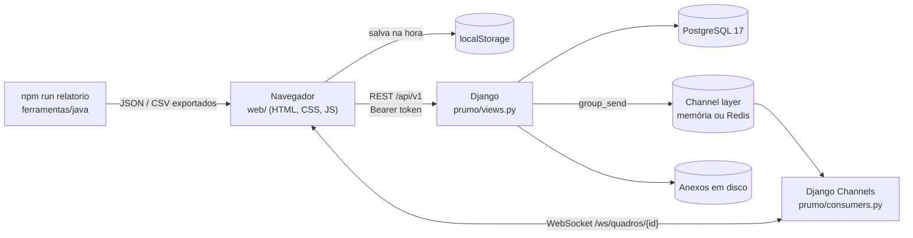

<p align="center">
  
</p>

<h1 align="center">Prumo<br><sub><sup><sup><sub>Copyright (©) 2026 Clara Portes</sub></sup></sup></sub></h1>

<p align="center">
  Quadro Kanban interativo escrito em JavaScript puro: arraste tarefas entre colunas, acompanhe prazos, limites WIP, dependências e automações, e veja lead time, cycle time e throughput no painel. Funciona sozinho no navegador ou com o servidor Django, salvando no PostgreSQL e sincronizando em tempo real entre várias pessoas.<br>
  Pronto para usar, estudar ou adaptar.
</p>

<p align="center">
  JavaScript (módulos ES, Drag and Drop nativo) · HTML5 · CSS3 · Python 3.13 · Django 6.1 · Django Channels (WebSockets) · PostgreSQL 17 · Java 21 · Docker Compose · Node Test Runner
</p>

---

> **Manual completo:** [`Manual-Prumo.pdf`](Manual-Prumo.pdf) explica a instalação, cada tela, o arrastar e soltar, automações, limites WIP, dependências, permissões, métricas, importação e exportação, a API, a ferramenta em Java, a configuração e a solução de problemas, passo a passo (cópia em [`docs/`](docs/Manual-Prumo.pdf)).

> **Banco de dados:** [`Banco-de-Dados-Prumo.pdf`](Banco-de-Dados-Prumo.pdf) traz o diagrama de relacionamentos, todas as tabelas com campos, tipos, chaves e restrições, o formato JSON do quadro, o controle de revisões, consultas prontas e como preparar o PostgreSQL.

<p align="center">
  
</p>

## O que o Prumo faz

- **Quadros personalizados:** crie, edite, duplique, arquive, restaure e exclua quadros. Cada quadro tem nome, descrição, cor, colunas, etiquetas, membros e automações próprios.
- **Modelos prontos:** Kanban (Backlog, To Do, In Progress, Review e Done), Scrum, Desenvolvimento, Estudos e Gestão de projetos.
- **Colunas dinâmicas:** adicione, renomeie e reorganize etapas arrastando o topo da coluna. Cada coluna tem um tipo (espera, em andamento ou concluído) que alimenta as métricas.
- **Drag and Drop nativo:** arraste tarefas entre colunas e mude a ordem dentro delas usando só a API de arrastar e soltar do HTML5, sem bibliotecas. Pelo teclado: `Alt` + setas.
- **Cards completos:** título, descrição, responsável, prioridade (urgente, alta, média, baixa), status, data de início e prazo.
- **Subtarefas e checklists:** divida a tarefa em passos menores, com barra de progresso no card.
- **Prazos e calendário:** visão mensal com as entregas de cada dia, lista de atrasadas e selos de “Hoje” e “Atrasada” nos cards.
- **Etiquetas e prioridades:** etiquetas coloridas por quadro e uma faixa lateral no card que indica a prioridade.
- **Busca e filtros:** encontre tarefas por texto, responsável, etiqueta, prioridade, prazo (atrasadas, hoje, próximos 7 dias, sem prazo) e status, tudo combinado.
- **Anexos:** imagens, documentos e qualquer arquivo. No modo local, até 2 MB por arquivo dentro do navegador; com o servidor, até 20 MB (configurável) gravados em disco.
- **Comentários com menções:** escreva `@nome` para avisar alguém.
- **Histórico de alterações:** cada criação, movimentação, edição, comentário e regra aplicada fica registrada com autor e horário, no quadro e em cada tarefa.
- **Desfazer e refazer:** até 100 passos com `Ctrl+Z` e `Ctrl+Y`, inclusive exclusões de quadros, colunas e tarefas.
- **Salvamento automático:** tudo vai para o `localStorage` na hora. Com o servidor, também para o PostgreSQL, com controle de revisão para nunca sobrescrever o trabalho de outra pessoa.

## Funcionalidades avançadas

- **Colaboração em tempo real:** com o servidor, cada alteração chega por WebSocket a quem estiver com o mesmo quadro aberto. A barra lateral mostra quem está online.
- **Painel analítico:** concluídas, pendentes, atrasadas, concluídas por semana, tarefas por coluna com o limite WIP, fluxo cumulativo de 14 dias, desempenho por responsável e pendências por prioridade.
- **Limites WIP:** defina quantas tarefas cabem em cada coluna. O contador fica vinho quando a coluna lota e o Prumo recusa a tarefa que passaria do limite.
- **Automações:** regras do tipo “quando a tarefa entrar em Review, atribuir ao Bruno” ou “quando for criada em To Do, prazo em 3 dias”. Ações disponíveis: definir responsável, prioridade, etiqueta, prazo, mover para outra coluna e marcar todas as subtarefas. As regras podem ser pausadas.
- **Notificações:** prazos vencendo ou vencidos, atribuições, menções e alterações feitas por outras pessoas nas suas tarefas, com alerta opcional do navegador.
- **Permissões:** administrador, gerente, membro e visualizador. A interface esconde o que o papel não permite e a API recusa a operação.
- **Dependências:** uma tarefa pode depender de outras. Ela fica listrada e marcada como bloqueada, e não avança enquanto as dependências não forem concluídas (ou só avisa, se você preferir). Ciclos são recusados.
- **Relatórios de produtividade:** lead time, cycle time e throughput no painel, na linha de comando (`npm run relatorio`) e na ferramenta em Java.
- **Exportação e importação:** um quadro ou todos em JSON e as tarefas em CSV (abre no Excel, LibreOffice e Google Planilhas). A importação de CSV cria colunas, etiquetas e dependências que faltarem.
- **API REST:** todas as operações do servidor ficam em `/api/v1`, com autenticação por token, para integrar com outras ferramentas.
- **Personalização visual:** tema claro, escuro ou do sistema, densidade confortável ou compacta, cor por quadro e layout que se adapta ao celular.

| Tela | |
|---|---|
|  |  |
|  |  |
|  |  |

## Arquitetura



| Camada | Onde | O que faz |
|---|---|---|
| Núcleo | `web/js/regras.js` · `estado.js` · `metricas.js` · `filtros.js` · `csv.js` | Regras do Kanban (mover, WIP, dependências, automações), estado com desfazer/refazer, métricas, filtros e conversão JSON/CSV. Funções puras, testadas no Node |
| Interface | `web/js/ui/` · `web/css/prumo.css` · `web/index.html` | Quadro com Drag and Drop, janela da tarefa, calendário, painel, histórico e diálogos |
| Sincronização | `web/js/api.js` · `web/js/app.js` | Cliente REST com token, salvamento com revisão, WebSocket com reconexão automática |
| API | `prumo/views.py` · `prumo/urls.py` | Django sem frameworks extras: autenticação por token, papéis por quadro, revisão otimista e histórico com autor |
| Tempo real | `prumo/consumers.py` · `prumo/asgi.py` | Daphne + Channels: avisa alterações, exclusões e quem está online |
| Ferramentas | `scripts/relatorio.js` · `ferramentas/java/` | Relatórios de produtividade pela linha de comando |

### Como o salvamento funciona

1. Toda alteração passa por `Loja.alterar()`, que guarda o estado anterior na pilha de desfazer e grava no `localStorage`.
2. Se o quadro está no servidor, o Prumo envia `PUT /api/v1/quadros/{id}` com a **revisão** que conhece e os registros novos do histórico.
3. O servidor trava a linha (`select_for_update`), confere a revisão e, se alguém salvou antes, responde **409** com a versão atual, que o navegador carrega na hora.
4. Ao aceitar, o servidor soma 1 à revisão, grava os registros com o autor do token e avisa os outros navegadores pelo WebSocket.
5. Membros não alteram colunas, etiquetas e automações; visualizadores não alteram nada. A regra vale no servidor, não só na tela.

## Como rodar

Você só precisa do **Docker** com Docker Compose.

**Windows:** dê dois cliques em `iniciar.cmd`.

**Linux ou macOS:**

```bash
./iniciar.sh
```

Na primeira vez o script cria o arquivo `.env` com senha e chave aleatórias, sobe o PostgreSQL e o Prumo e abre **http://localhost:8080**.

| Endereço | O que é |
|---|---|
| http://localhost:8080 | Quadro |
| http://localhost:8080/api/v1/ | Lista das rotas da API |
| http://localhost:8080/api/v1/saude | Estado do servidor |

Para rodar sem o script:

```bash
cp .env.example .env        # troque PRUMO_DB_PASSWORD e PRUMO_SECRET_KEY
docker compose up -d --build
```

**Só a interface, sem Docker nem banco:** com o Node 20 ou mais novo, rode `npm run servir` e abra http://localhost:5173. Tudo fica salvo no navegador.

**Servidor sem Docker:** com o Python 3.13, `pip install -r requirements.txt`, `python manage.py migrate`, `python manage.py seed` e `daphne prumo.asgi:application`. Sem `PRUMO_DB_ENGINE=postgresql`, o Django usa SQLite.

## Contas de demonstração

Todas usam a senha **`Prumo@2026`**. Elas existem só para testes, para qualquer pessoa entrar logo depois de baixar o projeto. Os nomes são fictícios e os e-mails usam o domínio de exemplo `prumo.dev`.

| Papel | E-mail | O que pode fazer |
|---|---|---|
| Administrador | `admin@prumo.dev` | Tudo, incluindo membros e exclusão do quadro |
| Gerente | `gerente@prumo.dev` | Tarefas, colunas, etiquetas, limites WIP e automações |
| Membro | `membro@prumo.dev` | Criar, editar, mover e comentar tarefas |
| Visualizador | `leitura@prumo.dev` | Só consultar |

Para entrar, clique no seu nome no canto inferior esquerdo e use **Entrar no servidor**. Para usar de verdade, suba com `PRUMO_SEED=false` num banco vazio e crie sua conta com `docker compose exec web python manage.py criarusuario --email voce@empresa.com --nome "Seu Nome" --admin`.

## Atalhos

| Tecla | Ação |
|---|---|
| `Ctrl` + `Z` / `Ctrl` + `Y` | Desfazer / refazer |
| `/` | Buscar |
| `N` | Nova tarefa na primeira coluna |
| `1` a `4` | Quadro, calendário, painel e histórico |
| `Enter` | Abrir a tarefa em foco |
| `Alt` + `←` `→` | Mover a tarefa entre colunas |
| `Alt` + `↑` `↓` | Mudar a ordem na coluna |
| `?` | Lista de atalhos |

## API

Todas as rotas ficam em `/api/v1`, respondem JSON e exigem `Authorization: Bearer <token>`, exceto login, saúde e o índice. Erros vêm sempre como `{ "mensagem": "..." }`.

| Grupo | Rotas |
|---|---|
| Acesso | `POST /auth/entrar` · `POST /auth/sair` · `GET /auth/eu` |
| Quadros | `GET` e `POST /quadros` · `GET`, `PUT` e `DELETE /quadros/{id}` |
| Consultas | `GET /quadros/{id}/historico` · `GET /quadros/{id}/tarefas?coluna=&responsavel=&etiqueta=&prioridade=` |
| Membros | `GET` e `POST /quadros/{id}/membros` com `{ "email", "papel" }` (papel `remover` tira o acesso) |
| Anexos | `POST /quadros/{id}/anexos` (multipart: `card`, `arquivo`) · `GET /anexos/{id}` |
| Tempo real | `WS /ws/quadros/{id}/?token=...` com os eventos `quadro`, `presenca` e `excluido` |

```bash
TOKEN=$(curl -s -X POST localhost:8080/api/v1/auth/entrar -H 'Content-Type: application/json' \
  -d '{"email":"gerente@prumo.dev","senha":"Prumo@2026"}' | jq -r .token)

curl -s "localhost:8080/api/v1/quadros/qdr_demonstracao/tarefas?responsavel=Carla%20Dias" \
  -H "Authorization: Bearer $TOKEN"
```

## Relatórios pela linha de comando

Exporte o quadro em **Menu → Exportar e importar** e rode:

```bash
npm run relatorio -- quadro.json                               # JavaScript (Node)
bash ferramentas/java/prumo.sh resumo tarefas.csv              # Java 21
bash ferramentas/java/prumo.sh atrasadas tarefas.csv
bash ferramentas/java/prumo.sh responsaveis tarefas.csv
```

No Windows, use `ferramentas\java\prumo.cmd` no lugar de `prumo.sh`.

## Configuração

Todas as variáveis ficam no arquivo `.env` (modelo em [`.env.example`](.env.example)).

| Variável | Padrão | Para que serve |
|---|---|---|
| `PRUMO_PORT` | `8080` | Porta do Prumo no seu computador |
| `PRUMO_SECRET_KEY` | gerada | `SECRET_KEY` do Django |
| `PRUMO_DB_NAME` / `PRUMO_DB_USER` / `PRUMO_DB_PASSWORD` | `prumo` / `prumo` / gerada | Acesso ao PostgreSQL |
| `PRUMO_SEED` | `true` | Contas e quadro de demonstração num banco vazio |
| `PRUMO_ALLOWED_HOSTS` | `localhost,127.0.0.1` | Domínios aceitos pelo Django |
| `PRUMO_HTTPS` | `false` | Redireciona para HTTPS atrás de um proxy |
| `PRUMO_MAX_ANEXO_MB` | `20` | Tamanho máximo de cada anexo |
| `PRUMO_TOKEN_HORAS` | `168` | Validade do login |
| `PRUMO_REDIS_URL` | vazio | Use Redis no channel layer para rodar mais de uma instância |
| `PRUMO_TIMEZONE` | `America/Sao_Paulo` | Fuso do servidor |

## Personalizando

| Quero… | Onde mexer |
|---|---|
| Mudar as cores | Variáveis no topo de `web/css/prumo.css` (tema claro e escuro) |
| Criar um modelo de quadro | `MODELOS` em `web/js/modelos.js` |
| Criar uma ação de automação | `DESCRICOES_ACAO` e `executarAutomacoes` em `web/js/regras.js`, e o campo em `web/js/ui/dialogos.js` |
| Adicionar uma métrica | `web/js/metricas.js` e `renderizarPainel` em `web/js/ui/vistas.js` |
| Mudar o que cada papel pode | `web/js/permissoes.js` (tela) e `exigir` em `prumo/views.py` (servidor) |
| Mudar o quadro de exemplo | `web/js/demonstracao.js` e depois `node scripts/exportar-exemplo.js` |

## Segurança

| Regra | Como funciona |
|---|---|
| Senhas | Hasher padrão do Django (PBKDF2 com sal), mínimo de 8 caracteres e não só números |
| Tokens | Aleatórios de 256 bits; só o SHA-256 fica no banco. Expiram em 7 dias e são revogados ao sair |
| Papéis | Conferidos em cada rota e na conexão do WebSocket |
| Conflitos | Revisão otimista com trava de linha: ninguém sobrescreve uma versão que não viu |
| Anexos | Nome aleatório no disco, tamanho limitado e download com `nosniff` e CSP restrita |
| Cabeçalhos | `X-Frame-Options: DENY` e `X-Content-Type-Options: nosniff` |
| Dados | Nenhum dado pessoal real no repositório. Segredos só no `.env`, que fica fora do Git |

## Estrutura

```
Interactive-Kanban-Board/
├── web/                         interface (sem build)
│   ├── index.html
│   ├── css/prumo.css            paleta, temas claro e escuro, layout
│   └── js/
│       ├── regras.js            mover, WIP, dependências, automações, histórico
│       ├── estado.js            loja com desfazer/refazer e localStorage
│       ├── metricas.js          lead time, cycle time, throughput, fluxo cumulativo
│       ├── filtros.js · csv.js · notificacoes.js · permissoes.js · modelos.js
│       ├── api.js               cliente REST e WebSocket
│       ├── app.js               inicialização, atalhos e sincronização
│       └── ui/                  quadro, tarefa, vistas e diálogos
├── prumo/                       servidor Django
│   ├── models.py                Quadro, Membro, Registro, Anexo e Token
│   ├── views.py · urls.py       API REST
│   ├── consumers.py · asgi.py   WebSocket com Channels
│   ├── management/commands/     seed e criarusuario
│   └── tests.py                 testes da API, permissões e WebSocket
├── ferramentas/java/            relatórios em Java a partir do CSV
├── scripts/                     servidor local, relatório em Node e utilitários
├── tests/js/                    testes do núcleo (node --test)
├── exemplos/                    quadro de demonstração em JSON
├── docs/                        manuais em PDF e imagens
└── docker-compose.yml
```

## Testes

```bash
npm test                                   # núcleo em JavaScript
python manage.py test prumo                # API, permissões e WebSocket (SQLite)
bash ferramentas/java/testar.sh            # ferramenta em Java
```

São 31 testes do núcleo (mover, WIP, dependências e ciclos, automações em cadeia, desfazer/refazer, métricas, filtros, notificações, CSV e JSON, cliente da API) e 20 testes do servidor (login, tokens, revisão e conflito, papéis, membros, anexos e WebSocket). O workflow [`ci.yml`](.github/workflows/ci.yml) roda tudo, com PostgreSQL 17, a cada envio.

## Licença

Copyright (©) 2026 Clara Portes

Este projeto é distribuído sob a licença [MIT](LICENSE). Você pode usar, copiar, modificar e redistribuir o código, inclusive para fins comerciais, desde que mantenha o aviso de copyright e o texto da licença.
