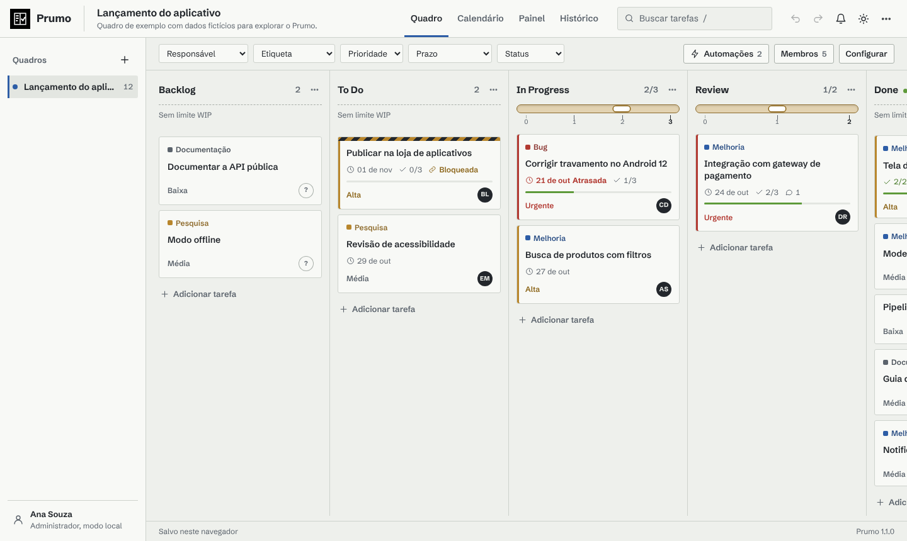
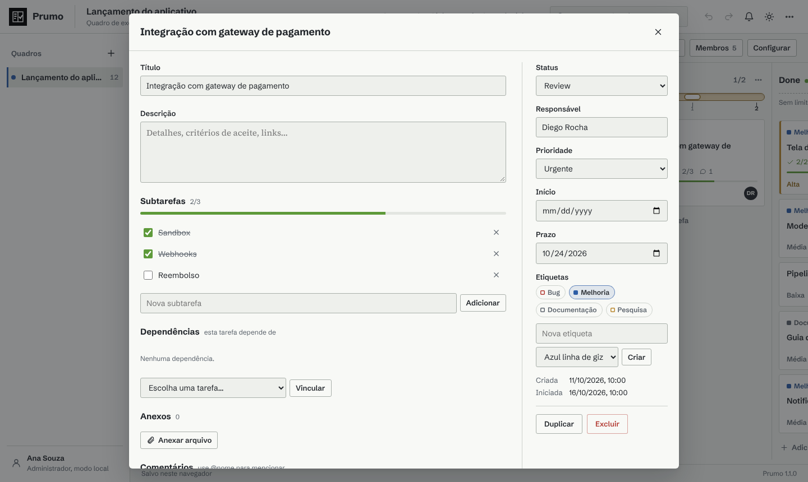
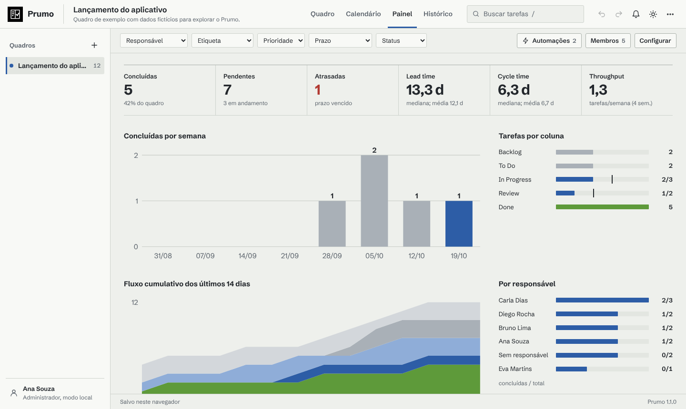
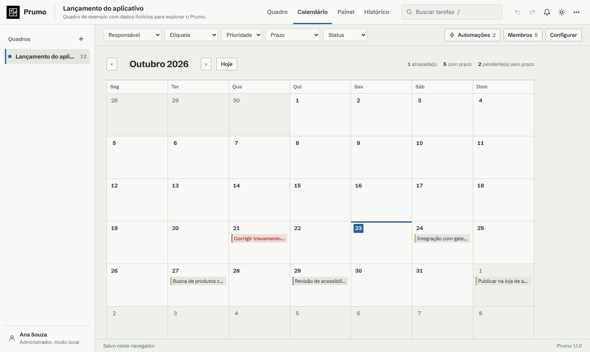
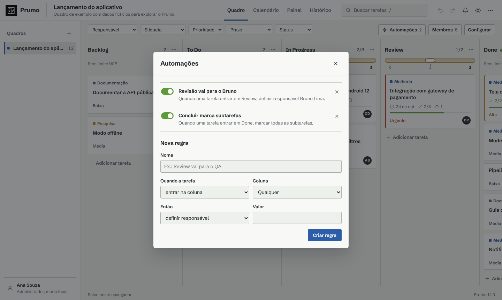
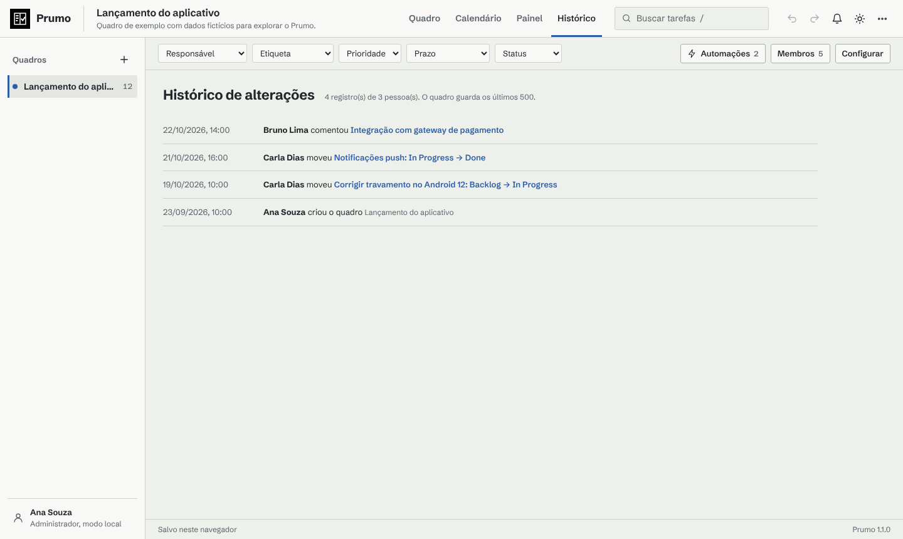
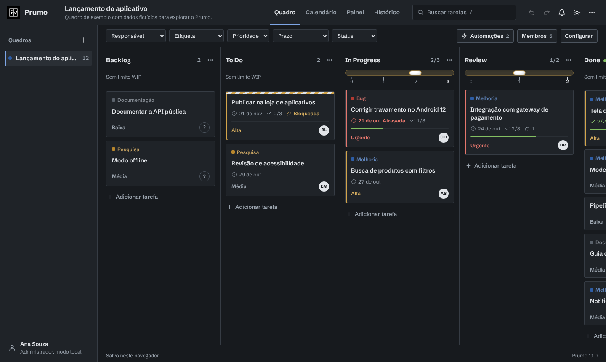
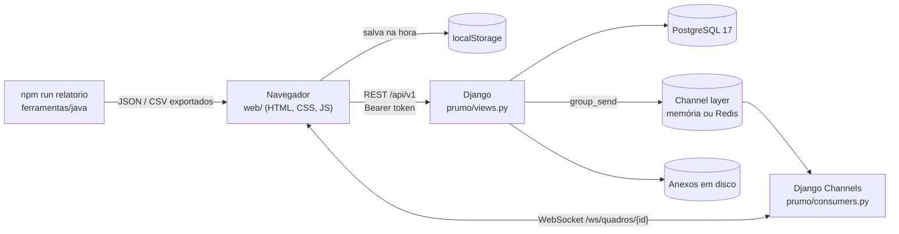

<p align="center">
  
</p>

<h1 align="center">Prumo<br><sub><sup><sup><sub>Copyright (©) 2026 Clara Portes</sub></sup></sup></sub></h1>

<p align="center">
  Quadro Kanban interativo escrito em JavaScript puro, com API REST em Django. Versão 1.1.0.
</p>

O Prumo organiza tarefas em colunas que você arrasta com o mouse ou pelo teclado. Cada coluna pode ter limite WIP, as tarefas têm prazos, dependências, subtarefas, anexos e comentários, e um painel calcula lead time, cycle time e throughput. Ele funciona sozinho no navegador, salvando no `localStorage`, ou com o servidor Django, que grava no PostgreSQL, controla contas e papéis e sincroniza o quadro em tempo real entre várias pessoas.

Feito com JavaScript (módulos ES e Drag and Drop nativo), HTML5 e CSS3 na interface; Python 3.13, Django 6.1, Django Channels e PostgreSQL 17 no servidor; Java 21 e Node.js para relatórios; Docker Compose para subir tudo; Node Test Runner nos testes.

<p align="center">
  
</p>

## Manuais

- [`Manual-Prumo.pdf`](Manual-Prumo.pdf) ([cópia em `docs/`](docs/Manual-Prumo.pdf)): instalação, cada tela, arrastar e soltar, automações, limites WIP, dependências, permissões, métricas, importação e exportação, API, ferramenta em Java, configuração e solução de problemas, passo a passo.
- [`Banco-de-Dados-Prumo.pdf`](Banco-de-Dados-Prumo.pdf): diagrama de relacionamentos, todas as tabelas com campos, tipos, chaves e restrições, formato JSON do quadro, controle de revisões, consultas prontas e preparação do PostgreSQL.

## Novidades da 1.1.0

A 1.1.0 muda só a aparência. API, formato JSON e banco continuam iguais aos da 1.0.0.

- Fundo cor de giz, texto grafite e colunas separadas por linhas finas.
- O limite WIP aparece como um nível de bolha com régua no topo da coluna, que fica vermelho quando a coluna lota. Colunas sem limite mostram “Sem limite WIP”.
- Tarefa bloqueada tem uma faixa zebrada no topo; prioridade urgente ou alta aparece como uma barra à esquerda do card.
- Os seletores de cor mostram nomes (“Azul linha de giz”, “Latão”) em vez de códigos hexadecimais.
- Tipografia nova: Schibsted Grotesk na interface e Source Serif 4 nos textos longos, com as fontes dentro do projeto.
- Capturas de tela e manuais em PDF refeitos.

## Ver rodando

Você só precisa do Docker com Docker Compose.

No Windows, dê dois cliques em `iniciar.cmd`. No Linux ou no macOS:

```bash
./iniciar.sh
```

Na primeira vez, o script cria o arquivo `.env` com senha e chave aleatórias, sobe o PostgreSQL e o Prumo e abre http://localhost:8080.

| Endereço | O que é |
|---|---|
| http://localhost:8080 | Quadro |
| http://localhost:8080/api/v1/ | Lista das rotas da API |
| http://localhost:8080/api/v1/saude | Estado do servidor |

### Contas de demonstração

Todas usam a senha `Prumo@2026`. Elas existem para que qualquer pessoa consiga entrar logo depois de baixar o projeto. Os nomes são fictícios e os e-mails usam o domínio de exemplo `prumo.dev`.

| Papel | E-mail | O que pode fazer |
|---|---|---|
| Administrador | `admin@prumo.dev` | Tudo, incluindo membros e exclusão do quadro |
| Gerente | `gerente@prumo.dev` | Tarefas, colunas, etiquetas, limites WIP e automações |
| Membro | `membro@prumo.dev` | Criar, editar, mover e comentar tarefas |
| Visualizador | `leitura@prumo.dev` | Só consultar |

Para entrar, clique no seu nome no canto inferior esquerdo e use **Entrar no servidor**.

## Instalar

### Com Docker, sem o script

```bash
cp .env.example .env        # troque PRUMO_DB_PASSWORD e PRUMO_SECRET_KEY
docker compose up -d --build
```

Para uso real, suba com `PRUMO_SEED=false` num banco vazio e crie a sua conta:

```bash
docker compose exec web python manage.py criarusuario --email voce@empresa.com --nome "Seu Nome" --admin
```

### Só a interface, sem Docker nem banco

Com o Node 20 ou mais novo, rode `npm run servir` e abra http://localhost:5173. Tudo fica salvo no navegador.

### Servidor sem Docker

Com o Python 3.13:

```bash
pip install -r requirements.txt
python manage.py migrate
python manage.py seed
daphne prumo.asgi:application
```

Sem `PRUMO_DB_ENGINE=postgresql`, o Django usa SQLite.

## Usar

O quadro guarda cada alteração na hora. Com ele você pode:

- criar, editar, duplicar, arquivar, restaurar e excluir quadros, cada um com nome, descrição, cor, colunas, etiquetas, membros e automações próprios;
- começar de um modelo: Kanban (Backlog, To Do, In Progress, Review e Done), Scrum, Desenvolvimento, Estudos ou Gestão de projetos;
- adicionar, renomear e reordenar colunas arrastando o topo. Cada coluna tem um tipo (espera, em andamento ou concluído) que alimenta as métricas;
- arrastar tarefas entre colunas e dentro delas usando só a API de arrastar e soltar do HTML5, ou `Alt` + setas pelo teclado;
- preencher título, descrição, responsável, prioridade (urgente, alta, média, baixa), status, início e prazo, e dividir a tarefa em subtarefas com barra de progresso;
- ver os prazos no calendário do mês, com a lista de atrasadas e os selos “Hoje” e “Atrasada” nos cards;
- buscar por texto e filtrar por responsável, etiqueta, prioridade, prazo (atrasadas, hoje, próximos 7 dias, sem prazo) e status, tudo combinado;
- anexar imagens, documentos ou qualquer arquivo: até 2 MB por arquivo no modo local, dentro do navegador; até 20 MB (configurável) em disco com o servidor;
- comentar e mencionar alguém com `@nome`;
- consultar o histórico de criações, movimentações, edições, comentários e regras aplicadas, com autor e horário, no quadro e em cada tarefa;
- desfazer e refazer até 100 passos com `Ctrl+Z` e `Ctrl+Y`, inclusive exclusões de quadros, colunas e tarefas.

Para equipes e para acompanhar o fluxo:

- Limites WIP. Defina quantas tarefas cabem em cada coluna. O nível de bolha mostra a ocupação e o Prumo recusa a tarefa que passaria do limite.
- Dependências. Uma tarefa bloqueada ganha a faixa zebrada e não avança enquanto as dependências não forem concluídas, ou só avisa, se você preferir. Ciclos são recusados.
- Automações. Regras como “quando a tarefa entrar em Review, atribuir ao Bruno” ou “quando for criada em To Do, prazo em 3 dias”. As ações são definir responsável, prioridade, etiqueta, prazo, mover para outra coluna e marcar todas as subtarefas. Uma regra pode ser pausada.
- Painel. Concluídas, pendentes, atrasadas, concluídas por semana, tarefas por coluna com o limite WIP, fluxo cumulativo dos últimos 14 dias, desempenho por responsável e pendências por prioridade.
- Notificações de prazos vencendo ou vencidos, atribuições, menções e alterações de outras pessoas nas suas tarefas, com alerta opcional do navegador.
- Permissões por quadro: administrador, gerente, membro e visualizador. A interface esconde o que o papel não permite e a API recusa a operação.
- Colaboração em tempo real. Com o servidor, cada alteração chega por WebSocket a quem estiver com o mesmo quadro aberto, e a barra lateral mostra quem está online.
- Exportação e importação de um quadro ou de todos em JSON e das tarefas em CSV (abre no Excel, LibreOffice e Google Planilhas). A importação de CSV cria as colunas, etiquetas e dependências que faltarem.
- Tema claro, escuro ou do sistema, densidade confortável ou compacta, cor por quadro e layout para celular.

| | |
|---|---|
|  |  |
|  |  |
|  |  |

### Atalhos

| Tecla | Ação |
|---|---|
| `Ctrl` + `Z` / `Ctrl` + `Y` | Desfazer / refazer |
| `/` | Buscar |
| `N` | Nova tarefa na primeira coluna |
| `1` a `4` | Quadro, calendário, painel e histórico |
| `Enter` | Abrir a tarefa em foco |
| `Alt` + `←` `→` | Mover a tarefa entre colunas |
| `Alt` + `↑` `↓` | Mudar a ordem na coluna |
| `?` | Lista de atalhos |

### Relatórios pela linha de comando

Exporte o quadro em Menu › Exportar e importar e rode:

```bash
npm run relatorio -- quadro.json                               # JavaScript (Node)
bash ferramentas/java/prumo.sh resumo tarefas.csv              # Java 21
bash ferramentas/java/prumo.sh atrasadas tarefas.csv
bash ferramentas/java/prumo.sh responsaveis tarefas.csv
```

No Windows, use `ferramentas\java\prumo.cmd` no lugar de `prumo.sh`. Lead time, cycle time e throughput saem no painel, no relatório em Node e na ferramenta em Java.

## Por dentro



| Camada | Onde | O que faz |
|---|---|---|
| Núcleo | `web/js/regras.js`, `estado.js`, `metricas.js`, `filtros.js`, `csv.js` | Regras do Kanban (mover, WIP, dependências, automações), estado com desfazer e refazer, métricas, filtros e conversão JSON/CSV. Funções puras, testadas no Node |
| Interface | `web/js/ui/`, `web/css/prumo.css`, `web/index.html` | Quadro com Drag and Drop, janela da tarefa, calendário, painel, histórico e diálogos |
| Sincronização | `web/js/api.js`, `web/js/app.js` | Cliente REST com token, salvamento com revisão, WebSocket com reconexão automática |
| API | `prumo/views.py`, `prumo/urls.py` | Django sem frameworks extras: autenticação por token, papéis por quadro, revisão otimista e histórico com autor |
| Tempo real | `prumo/consumers.py`, `prumo/asgi.py` | Daphne e Channels: avisa alterações, exclusões e quem está online |
| Ferramentas | `scripts/relatorio.js`, `ferramentas/java/` | Relatórios de produtividade pela linha de comando |

### Como o salvamento funciona

1. Toda alteração passa por `Loja.alterar()`, que guarda o estado anterior na pilha de desfazer e grava no `localStorage`.
2. Se o quadro está no servidor, o Prumo envia `PUT /api/v1/quadros/{id}` com a revisão que conhece e os registros novos do histórico.
3. O servidor trava a linha (`select_for_update`) e confere a revisão. Se alguém salvou antes, responde 409 com a versão atual, que o navegador carrega na hora.
4. Ao aceitar, o servidor soma 1 à revisão, grava os registros com o autor do token e avisa os outros navegadores pelo WebSocket.
5. Membros não alteram colunas, etiquetas e automações; visualizadores não alteram nada. A regra vale no servidor, não só na tela.

### Segurança

| Regra | Como funciona |
|---|---|
| Senhas | Hasher padrão do Django (PBKDF2 com sal), mínimo de 8 caracteres e não só números |
| Tokens | Aleatórios de 256 bits; só o SHA-256 fica no banco. Expiram em 7 dias e são revogados ao sair |
| Papéis | Conferidos em cada rota e na conexão do WebSocket |
| Conflitos | Revisão otimista com trava de linha: ninguém sobrescreve uma versão que não viu |
| Anexos | Nome aleatório no disco, tamanho limitado e download com `nosniff` e CSP restrita |
| Cabeçalhos | `X-Frame-Options: DENY` e `X-Content-Type-Options: nosniff` |
| Dados | Nenhum dado pessoal real no repositório. Segredos só no `.env`, que fica fora do Git |

### Estrutura

```
Interactive-Kanban-Board/
├── web/                         interface (sem build)
│   ├── index.html
│   ├── css/prumo.css            paleta, temas claro e escuro, layout
│   └── js/
│       ├── regras.js            mover, WIP, dependências, automações, histórico
│       ├── estado.js            loja com desfazer/refazer e localStorage
│       ├── metricas.js          lead time, cycle time, throughput, fluxo cumulativo
│       ├── filtros.js, csv.js, notificacoes.js, permissoes.js, modelos.js
│       ├── api.js               cliente REST e WebSocket
│       ├── app.js               inicialização, atalhos e sincronização
│       └── ui/                  quadro, tarefa, vistas e diálogos
├── prumo/                       servidor Django
│   ├── models.py                Quadro, Membro, Registro, Anexo e Token
│   ├── views.py, urls.py        API REST
│   ├── consumers.py, asgi.py    WebSocket com Channels
│   ├── management/commands/     seed e criarusuario
│   └── tests.py                 testes da API, permissões e WebSocket
├── ferramentas/java/            relatórios em Java a partir do CSV
├── scripts/                     servidor local, relatório em Node e utilitários
├── tests/js/                    testes do núcleo (node --test)
├── exemplos/                    quadro de demonstração em JSON
├── docs/                        manuais em PDF e imagens
└── docker-compose.yml
```

## Referência

### API

Todas as rotas ficam em `/api/v1`, respondem JSON e exigem `Authorization: Bearer <token>`, exceto login, saúde e o índice. Erros vêm sempre como `{ "mensagem": "..." }`.

| Grupo | Rotas |
|---|---|
| Acesso | `POST /auth/entrar`, `POST /auth/sair`, `GET /auth/eu` |
| Quadros | `GET` e `POST /quadros`; `GET`, `PUT` e `DELETE /quadros/{id}` |
| Consultas | `GET /quadros/{id}/historico`, `GET /quadros/{id}/tarefas?coluna=&responsavel=&etiqueta=&prioridade=` |
| Membros | `GET` e `POST /quadros/{id}/membros` com `{ "email", "papel" }` (papel `remover` tira o acesso) |
| Anexos | `POST /quadros/{id}/anexos` (multipart: `card`, `arquivo`), `GET /anexos/{id}` |
| Tempo real | `WS /ws/quadros/{id}/?token=...` com os eventos `quadro`, `presenca` e `excluido` |

```bash
TOKEN=$(curl -s -X POST localhost:8080/api/v1/auth/entrar -H 'Content-Type: application/json' \
  -d '{"email":"gerente@prumo.dev","senha":"Prumo@2026"}' | jq -r .token)

curl -s "localhost:8080/api/v1/quadros/qdr_demonstracao/tarefas?responsavel=Carla%20Dias" \
  -H "Authorization: Bearer $TOKEN"
```

### Configuração

Todas as variáveis ficam no arquivo `.env` (modelo em [`.env.example`](.env.example)). A lista completa está no manual.

| Variável | Padrão | Para que serve |
|---|---|---|
| `PRUMO_PORT` | `8080` | Porta do Prumo no seu computador |
| `PRUMO_SECRET_KEY` | gerada | `SECRET_KEY` do Django |
| `PRUMO_DB_NAME` / `PRUMO_DB_USER` / `PRUMO_DB_PASSWORD` | `prumo` / `prumo` / gerada | Acesso ao PostgreSQL |
| `PRUMO_SEED` | `true` | Contas e quadro de demonstração num banco vazio |
| `PRUMO_ALLOWED_HOSTS` | `localhost,127.0.0.1` | Domínios aceitos pelo Django |
| `PRUMO_HTTPS` | `false` | Redireciona para HTTPS atrás de um proxy |
| `PRUMO_MAX_ANEXO_MB` | `20` | Tamanho máximo de cada anexo |
| `PRUMO_TOKEN_HORAS` | `168` | Validade do login |
| `PRUMO_REDIS_URL` | vazio | Redis no channel layer, para rodar mais de uma instância |
| `PRUMO_TIMEZONE` | `America/Sao_Paulo` | Fuso do servidor |

### Personalizando

| Para | Onde mexer |
|---|---|
| Mudar as cores | Variáveis no topo de `web/css/prumo.css` (tema claro e escuro) |
| Criar um modelo de quadro | `MODELOS` em `web/js/modelos.js` |
| Criar uma ação de automação | `DESCRICOES_ACAO` e `executarAutomacoes` em `web/js/regras.js`, e o campo em `web/js/ui/dialogos.js` |
| Adicionar uma métrica | `web/js/metricas.js` e `renderizarPainel` em `web/js/ui/vistas.js` |
| Mudar o que cada papel pode | `web/js/permissoes.js` (tela) e `exigir` em `prumo/views.py` (servidor) |
| Mudar o quadro de exemplo | `web/js/demonstracao.js` e depois `node scripts/exportar-exemplo.js` |

### Testes

```bash
npm test                                   # núcleo em JavaScript
python manage.py test prumo                # API, permissões e WebSocket (SQLite)
bash ferramentas/java/testar.sh            # ferramenta em Java
```

São 31 testes do núcleo (mover, WIP, dependências e ciclos, automações em cadeia, desfazer e refazer, métricas, filtros, notificações, CSV e JSON, cliente da API) e 20 do servidor (login, tokens, revisão e conflito, papéis, membros, anexos e WebSocket). O workflow [`ci.yml`](.github/workflows/ci.yml) roda tudo, com PostgreSQL 17, a cada envio.

### Gerar os manuais

Os PDFs saem de `.design/docs-src/` (HTML, `print.css` e fontes). Com Python, `playwright` e `pypdf` instalados:

```bash
python .design/docs-src/render.py
```

O script grava `Manual-Prumo.pdf` e `Banco-de-Dados-Prumo.pdf` na raiz e em `docs/`, usando as capturas de `docs/images/`.

## Licença

Copyright (©) 2026 Clara Portes

Este projeto é distribuído sob a licença [MIT](LICENSE). Você pode usar, copiar, modificar e redistribuir o código, inclusive para fins comerciais, desde que mantenha o aviso de copyright e o texto da licença.
